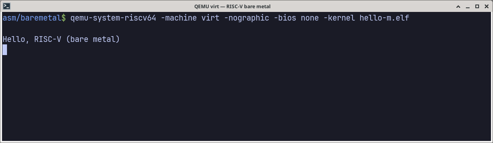

# asm — tiny RV64 programs, no libc

A handful of RISC-V 64-bit Linux programs written in GNU assembler. They talk
to the kernel with raw syscalls (`ecall`) — no C, no libc, no start files.
The point is to actually *see* the ISA from the [main README](../README.md#what-is-risc-v)
in real instructions: `write`/`exit`/`read`/`openat`, `div`/`rem` from the
**M** extension, the calling convention, argc/argv as the kernel left them
on the stack.

The programs in this directory are ordinary Linux userspace programs. They
run on the VisionFive 2 (or any RV64 Linux) and, on an x86 machine, under
`qemu-riscv64`. There's also a [bare-metal hello](baremetal/) that skips
the OS entirely and writes the UART itself.

Assembling a 40-line `.s` file is **not** "compiling the world." `as` and `ld`
finish in a blink even on the 1.5 GHz U74. That's a different beast from
emerging a desktop.

## What's here

| file | what it shows |
|------|----------------|
| [`hello.s`](hello.s) | `write` (syscall 64) + `exit` (93) — the smallest useful program |
| [`fizzbuzz.s`](fizzbuzz.s) | loops, `div`/`rem` (M extension), integer-to-decimal |
| [`args.s`](args.s) | `argc`/`argv` as laid out on the stack at `_start` |
| [`cat.s`](cat.s) | `read` (63), `openat` (56), `close` (57) — stdin or files to stdout |
| [`baremetal/`](baremetal/) | no OS at all — print to the QEMU `virt` UART and `wfi` |

## Build and run

**On an x86 (or any non-riscv64) machine**, you need a RISC-V assembler/linker
and qemu-user:

```sh
# Debian 13+
sudo apt install binutils-riscv64-linux-gnu qemu-user

# Ubuntu / older Debian (the qemu binary is often named qemu-riscv64-static)
sudo apt install binutils-riscv64-linux-gnu qemu-user-static

# Alpine (x86)
doas apk add binutils-riscv64 qemu-riscv64
make CROSS=riscv64-alpine-linux-musl-

# Nix
nix-shell -p qemu pkgsCross.riscv64-multiplatform.buildPackages.binutils
make CROSS=riscv64-unknown-linux-gnu-
```

Then, from this directory:

```sh
make
make run          # hello, fizzbuzz 1..100, args, cat — via qemu-riscv64
```

`make` defaults to the Debian/Ubuntu prefix `riscv64-linux-gnu-`. Override it
with `CROSS=...` as above, or `QEMU=qemu-riscv64-static` if that's the binary
you have.

**On the VisionFive 2 itself** (or any riscv64 Alpine box), you don't need a
cross toolchain or qemu. Alpine's `binutils` gives you `as` and `ld`:

```sh
doas apk add binutils
make CROSS=
./hello
./fizzbuzz
./args foo bar
./cat README.md
```

## Registers and the syscall ABI

Linux on RISC-V uses the standard integer calling convention, plus `ecall`
for syscalls. Syscall number goes in `a7`, arguments in `a0`–`a6`, return
value in `a0`.

| name | x-reg | role |
|------|-------|------|
| `zero` | x0 | hardwired zero |
| `ra` | x1 | return address (`call` / `ret`) |
| `sp` | x2 | stack pointer (16-byte aligned) |
| `gp` | x3 | global pointer |
| `tp` | x4 | thread pointer |
| `t0`–`t2` | x5–x7 | temporaries (caller-saved) |
| `s0`/`fp` | x8 | saved / frame pointer |
| `s1` | x9 | saved (callee-saved) |
| `a0`–`a1` | x10–x11 | arguments / return values |
| `a2`–`a7` | x12–x17 | arguments; **`a7` = syscall number** |
| `s2`–`s11` | x18–x27 | saved (callee-saved) |
| `t3`–`t6` | x28–x31 | temporaries (caller-saved) |

At `_start` (there is no `main` without libc) the stack is:

```
sp + 0             argc
sp + 8             argv[0]  → program name
sp + 16            argv[1]  → first argument, if any
…
sp + 8*(argc+1)    NULL
then envp[], a NULL, and the auxiliary vector
```

Useful syscall numbers on **riscv64** Linux (they are *not* the same as on
x86_64): `openat` 56, `close` 57, `read` 63, `write` 64, `exit` 93.

## Bare metal — no OS, just a UART

[`baremetal/`](baremetal/) is a different tree: no Linux, no syscalls, no
libc. The program writes `Hello, RISC-V (bare metal)` straight to a 16550
UART and then sits in `wfi`. You assemble it the same way as the others
(`as`/`ld`, not compiling the world) and run it in a QEMU *system* VM.

QEMU's `virt` machine puts an NS16550A at `0x10000000` with byte-spaced
registers. We poll the LSR's THRE bit at `+5`, then write the character to
the THR at `+0`. That's the whole driver.

Two boot paths, both built by `make`:

| target | load address | privilege | QEMU |
|--------|--------------|-----------|------|
| `hello-m.elf` | `0x80000000` | M-mode | `-bios none` — true bare metal, no firmware |
| `hello-s.elf` | `0x80200000` | S-mode | default OpenSBI, then the kernel — the way the VF2 boots |

```sh
# Debian/Ubuntu: qemu-system-riscv (and opensbi, for the S-mode path)
sudo apt install binutils-riscv64-linux-gnu qemu-system-riscv opensbi

cd baremetal
make
make run        # qemu-system-riscv64 -machine virt -nographic -bios none -kernel hello-m.elf
make run-s      # qemu-system-riscv64 -machine virt -nographic -kernel hello-s.elf
# Ctrl-A x quits QEMU
```

`-nographic` hooks the UART up to the terminal, so the hello lands on
stdio. M-mode is just our one line; S-mode prints the OpenSBI banner first,
then `Domain0 Next Address : 0x80200000` / `Next Mode : S-mode`, then the
hello. Other harts (if you pass `-smp N`) are parked in `wfi` on the M-mode
build; OpenSBI only starts the boot hart for S-mode.



**On the VisionFive 2:** uart0 really is at `0x10000000` too — that's in the
JH7110 device tree (`jh7110.dtsi`) and in StarFive's UART docs. But it's a
Synopsys DW 8250 (`snps,dw-apb-uart`) with `reg-shift = <2>` and
`reg-io-width = <4>`: the LSR lives at `+0x14`, not `+5`, and accesses are
32-bit. This program is written for QEMU virt's byte-spaced 16550 and is
**untested on the board**. Don't flash it expecting the same binary to just
work.
